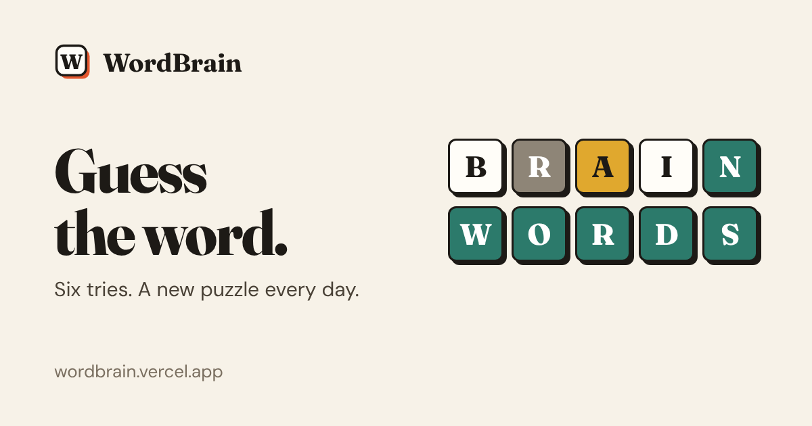

# WordBrain

A free word guessing game. Find the hidden word in six tries, then play another one.

Play it at **[wordbrain.vercel.app](https://wordbrain.vercel.app)**



## About

Most word guessing games give you one puzzle a day and then you wait. WordBrain keeps the daily
puzzle for the ritual, and adds unlimited games for the evenings when one isn't enough. It's free,
there are no ads and you don't need an account. Your stats stay in your browser.

## Features

- **Daily puzzle.** One five letter word a day, the same for everyone. A single attempt, a streak
  for every day in a row you solve it, a countdown to the next one, and a shareable grid that
  doesn't give the word away. Progress is saved if you close the tab halfway through.
- **Unlimited.** A fresh word every time, with 5, 6, 7 or 8 letters and easy, normal or hard
  word lists.
- **Practice.** Hints when you're stuck (show a letter, or rule out three), and nothing counts
  towards your stats.
- **Timed.** Two minutes per word. Pausing hides the board, so no free thinking time.
- **A real dictionary.** Guesses are checked against more than 100,000 English words, so real
  words don't get rejected. Answers come from shorter lists of everyday words.
- **What does it mean?** Every finished game links to the word on Wiktionary.
- **Hard mode, high contrast colours** (orange and blue with symbols, for colour-blind players),
  sound and animation toggles, light and dark themes.
- **Keyboard friendly.** Type straight onto the board; Enter submits, Backspace deletes.

## Run it locally

You need [Node.js](https://nodejs.org/) 18 or newer (20+ recommended).

```bash
git clone https://github.com/shoaibmarif/wordbrain.git
cd wordbrain
npm install
npm run dev
```

Then open <http://localhost:5173>.

### Scripts

| Command | What it does |
| --- | --- |
| `npm run dev` | Start the development server with hot reload |
| `npm run build` | Type-check and build the production site into `dist/` |
| `npm run preview` | Serve the production build locally |
| `npm test` | Run the tests (Vitest) |
| `npm run build:dictionary` | Rebuild `public/words/` from the `word-list` package |

The production build also writes a separate HTML file for every page, each with its own title,
description, social preview tags and structured data, plus `sitemap.xml`, `robots.txt` and
`404.html`.

## Project structure

```text
src/
  pages/             One component per page
  components/game/   Board, keyboard, mode tabs, result card, the game screen
  components/layout/ Header, footer, logo, page frame
  components/modals/ Help, statistics and settings
  context/           Settings, stats and dialogs shared across the app
  game/              Scoring, validation, hints, daily puzzle, sharing, sounds
  hooks/             Game state, timer, keyboard input, theme, storage
  data/              Answer lists, dictionary loader, FAQ
  seo/               Site config, per-page SEO metadata and structured data
  __tests__/         Unit tests and a render test for every page
public/words/        Guess dictionaries, one file per word length (loaded on demand)
scripts/             Build step for per-page HTML and the sitemap, dictionary builder
vercel.json          Hosting config: page routing, redirects, caching headers
```

Good places to start:

- **Name, domain and links:** `src/seo/site.ts`
- **Page titles and descriptions:** `src/seo/routes.ts`
- **Colours and fonts:** the tokens at the top of `src/index.css`
- **How guesses are scored:** `src/game/wordEvaluation.ts`
- **Daily word and streaks:** `src/game/daily.ts`

## Tech stack

React 19, TypeScript, Vite, Tailwind CSS 4, React Router and Vitest. Hosted on Vercel.

## Deploying

Import the repository into Vercel; it reads the build settings from `vercel.json`. If you deploy
somewhere else or use a different domain, update `url` in `src/seo/site.ts`.

## Credits

The guess dictionary comes from [word-list](https://github.com/sindresorhus/word-list) by Sindre
Sorhus (MIT licence), which is based on SCOWL. The licence is included in `public/words/`.

## Contributing

Bug reports, missing words and ideas are welcome. Please
[open an issue](https://github.com/shoaibmarif/wordbrain/issues) first for anything big, and run
`npm test` and `npm run build` before sending a pull request.

## Author

Made by **Shoaib Arif**

- Portfolio: [shoaibarif.vercel.app](https://shoaibarif.vercel.app/)
- LinkedIn: [linkedin.com/in/shoaibmarif](https://www.linkedin.com/in/shoaibmarif/)
- GitHub: [@shoaibmarif](https://github.com/shoaibmarif)
- Email: [shoaibmuhammadarif@gmail.com](mailto:shoaibmuhammadarif@gmail.com)
